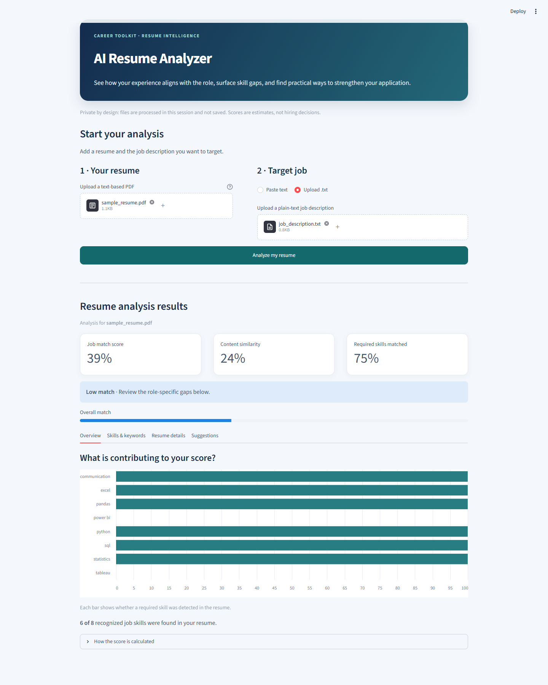

# AI Resume Analyzer

A beginner-friendly Streamlit project that extracts text from PDF resumes,
compares it with a pasted or uploaded job description, and reports an estimated
match score, skills, missing keywords, and improvement suggestions.

> **Important:** This tool is an educational aid, not a hiring decision or a
> substitute for a human review. It uses text similarity and transparent
> keyword matching; it can miss synonyms, context, and information in scanned
> documents. Review all suggestions and only add claims that are accurate.

## Features

- Upload a text-based PDF resume.
- Paste a job description or upload it as a UTF-8 `.txt` file.
- Extract configured skills, degree terms, experience durations, and
  qualification/certification terms.
- Compare both texts using TF-IDF and cosine similarity.
- Show an overall score, skill coverage, missing skills, and job keywords that
  were not found in the resume.
- Provide practical suggestions without automatically changing the resume.
- Keep the code split into small modules with focused tests.

## Project structure

```text
AI Resume Analyzer/
├── app.py
├── resume_parser.py
├── text_preprocessing.py
├── skill_extractor.py
├── job_matcher.py
├── evaluate.py
├── sample_data/
│   ├── sample_resume.pdf
│   └── job_description.txt
├── screenshots/
│   └── dashboard.png
├── tests/
│   └── test_analyzer.py
├── .gitignore
├── README.md
└── requirements.txt
```

### What each file does

- **`app.py`** — Builds the Streamlit page, accepts the resume and job
  description, calls the analysis modules, and displays results and suggestions.
- **`resume_parser.py`** — Extracts text from uploaded PDF bytes in memory.
- **`text_preprocessing.py`** — Normalizes text before matching while
  preserving useful symbols in technical terms.
- **`skill_extractor.py`** — Detects known skills, education, experience,
  qualifications, and high-priority missing job keywords.
- **`job_matcher.py`** — Uses TF-IDF and cosine similarity to compare the
  resume with the job description and calculate skill coverage.
- **`evaluate.py`** — Combines similarity and skill coverage into a match
  score and plain-language rating.
- **`sample_data/job_description.txt`** — Example data analyst role for trying
  out the analyzer.
- **`sample_data/sample_resume.pdf`** — Fictional sample resume for testing the
  PDF upload flow locally.
- **`screenshots/dashboard.png`** — Dashboard screenshot for the project page.
- **`tests/test_analyzer.py`** — Tests the analysis modules with sample resume
  and job-description text using Python's built-in `unittest` framework.
- **`requirements.txt`** — Lists the Python packages needed to run the app.
- **`.gitignore`** — Keeps Python caches, local environments, editor files,
  and Streamlit secrets out of Git.
- **`README.md`** — Documents setup, execution, the matching method, and the
  main code flow.

## Setup

Use Python 3.10 or newer. From the project root, create and activate a virtual
environment, then install the dependencies:

```powershell
python -m venv .venv
.\.venv\Scripts\Activate.ps1
python -m pip install -r requirements.txt
```

On macOS or Linux, activate the environment with:

```bash
source .venv/bin/activate
```

## Run the application

```bash
streamlit run app.py
```

Streamlit opens the app in a browser. Upload a searchable PDF, paste or upload
the job description, and select **Analyze resume**. Uploaded resumes are
processed in memory by this app; this project does not write them to disk or
send them to an external API.

To try the sample data, upload `sample_data/sample_resume.pdf` and choose
**Upload .txt** to select `sample_data/job_description.txt`. The fictional
resume intentionally has some, but not all, of the job's skills.

## Application screenshot



## GitHub

The project is organized for a GitHub repository named
`AI-Resume-Analyzer`. Include the Python modules, sample data, screenshot,
`README.md`, `requirements.txt`, and `.gitignore` when publishing.

## Run tests

```bash
python -m unittest discover -s tests -v
```

## How the analysis works

1. **PDF extraction:** PyPDF2 reads each page and combines the extracted text.
   Image-only scans have no text layer, so they need OCR before upload.
2. **Text similarity:** Scikit-learn converts the resume and job description
   into TF-IDF vectors using single words and two-word phrases. Cosine
   similarity measures how closely the vectors align.
3. **Skills:** A small, editable vocabulary is searched in both documents.
   Skills required by the description are marked as found or missing.
4. **Overall score:** When recognized job skills are present, the result is
   `70% text similarity + 30% required-skill coverage`. If none are found,
   the score uses text similarity alone. The result is clamped from 0 to 100.
5. **Keywords and suggestions:** High-weight job-description terms are ranked
   with TF-IDF; terms not present in the resume are shown as keywords to
   consider. The app also suggests clarifying education or work history when
   those details were not detected.

The extracted vocabularies are intentionally easy to inspect and extend in
`skill_extractor.py`. Keyword matching is not semantic understanding: for
example, two different phrases with the same meaning may not match.

## Important code flow

### `app.py`

1. `st.set_page_config` sets the browser title, icon, and wide layout.
2. The CSS and hero markup style the page; the rest of the interface uses
   Streamlit widgets.
3. The two file uploaders accept a PDF resume and an optional text job
   description. The text area allows the job description to be pasted instead.
4. The Analyze button checks that a resume was provided, calls
   `extract_text_from_pdf`, chooses the uploaded or pasted job description,
   then passes both texts through `match_resume_to_job` and `evaluate_match`.
5. Expected input/PDF errors are shown in the page. Successful results are
   stored in `st.session_state` so they remain visible during reruns.
6. The result sections render scores, skills, extracted details, and
   suggestions. The score expander explains the calculation and its limits.

### `resume_parser.py`

1. `BytesIO` wraps the uploaded bytes so `PdfReader` can read them without
   saving a resume file.
2. The function checks for empty input and handles PDFs that can be unlocked
   with an empty password.
3. It extracts each page's text, joins the pages, and raises a readable error
   if the document has no extractable text.

### `text_preprocessing.py`

`preprocess_text` lowercases the text, removes web links and email addresses,
preserves characters like `+` and `#`, and reduces repeated whitespace.

### `skill_extractor.py`

Vocabulary constants define which skills, degrees, and qualifications can be
detected. Extraction functions use whole-term matching to avoid partial
matches; `extract_keywords` ranks job-description terms with TF-IDF.

### `job_matcher.py`

`match_resume_to_job` validates both inputs, creates comparable TF-IDF vectors,
calculates cosine similarity, and checks for required skills. It returns a
dictionary containing scores, found/missing skills, and a Pandas skill table.

### `evaluate.py`

`calculate_match_score` combines similarity and skill coverage when the job
description contains known skills. `evaluate_match` adds the final score and
the Strong/Moderate/Low rating for display.

## Adding skills

Add a lowercase skill phrase to `SKILL_TERMS` in `skill_extractor.py`. Keep it
specific enough to avoid common-word false positives. Add education or
certification phrases to their respective term tuples as needed.
